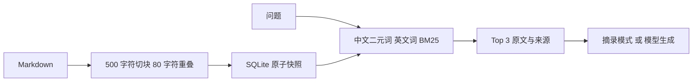

# 知识库 RAG 助手

面向开发支持场景的可复现学习项目：导入 Markdown 运维知识，按块检索，返回原文和来源；可选调用兼容 Chat Completions 的模型生成回答。

## 5 分钟运行

Python 3.11+，仅标准库，无需安装依赖。

```bash
python rag.py ingest knowledge
python rag.py ask "慢查询如何排查"
python -m unittest discover -s tests -v
python evaluate.py
```

默认输出 `mode: extractive`，只是检索摘录，**没有调用大模型**。`sources` 包含文档、块序号和 BM25 分数。
真实生成：在当前 shell 设置 `LLM_API_KEY`、`LLM_MODEL`，可选 `LLM_BASE_URL`，然后执行：

```bash
python rag.py ask "慢查询如何排查" --live
```

PowerShell 示例：`$env:LLM_MODEL="你的模型名"`。`.env.example` 只说明变量，不会自动载入。真实调用会将问题和检索到的资料发送给所配置的模型服务，产生服务商费用。

## 设计



选择词法 BM25 便于无 API、无向量数据库复现；本项目没有 embedding 或向量检索实现。重建索引在事务中替换，支持文档更新和删除。SQL 全部参数绑定。

## 验证与边界

测试覆盖中文检索、重建与删除、空问题、切块重叠、SQL 输入、模型适配接口。`evaluate.py` 的 8 个小样例衡量来源 Top1 或无匹配拒答，不能视为真实业务准确率。真实模型调用需自行配置 Key，本仓库测试使用 mock。

当前 BM25 在每次查询扫描全部块，适合小知识库，不适合大规模生产；仅支持 UTF-8 Markdown。拒答基于无词法重叠，存在弱相关误召回风险；生成模式的引用与事实一致性未自动验证。后续可增加混合检索、rerank、引用核对和独立评估集。

参阅 [开发与排障文档](docs/design.md)。
