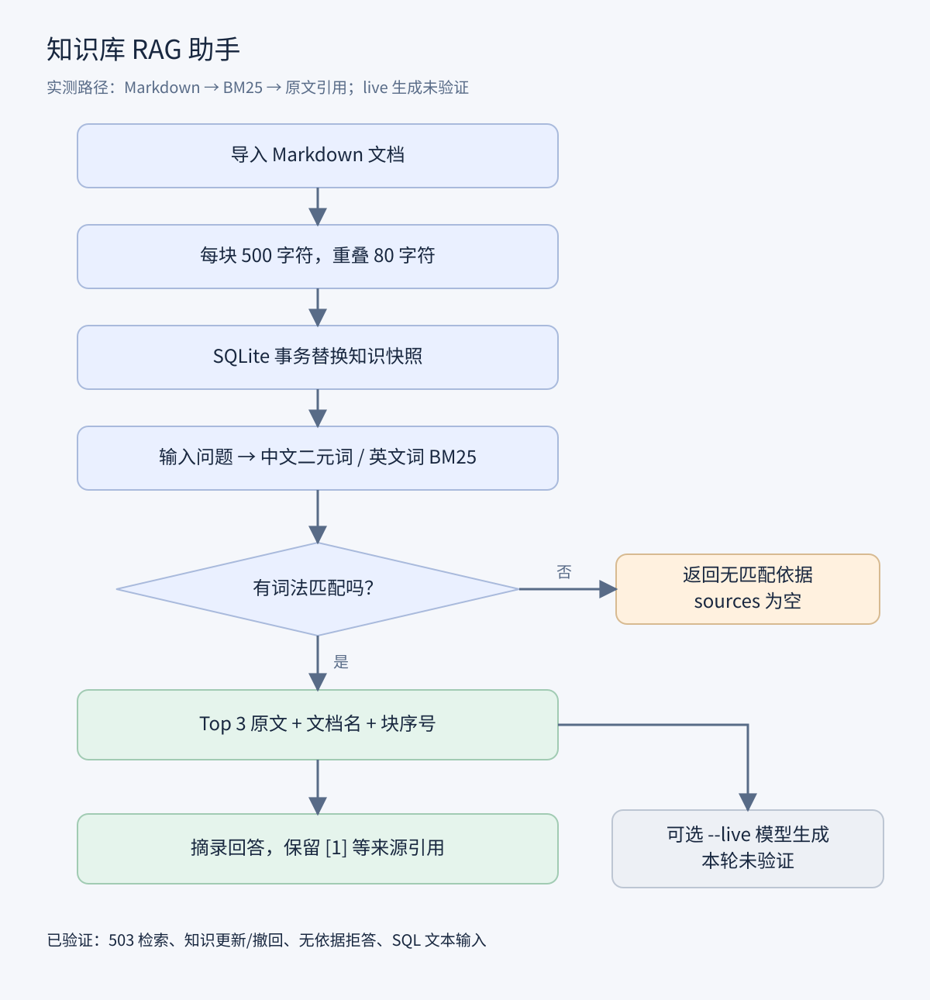
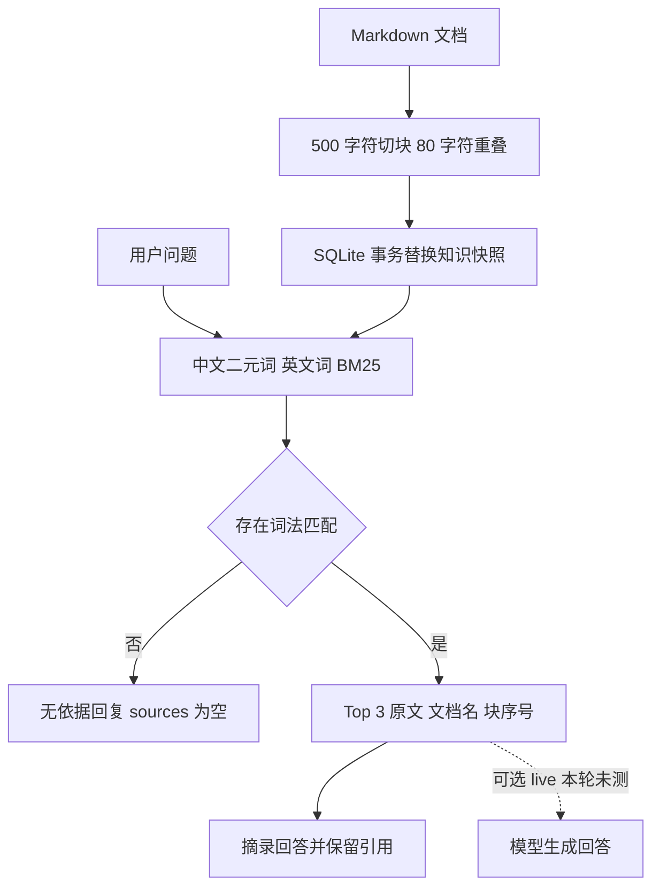

# 业务案例验收 rag-knowledge-assistant

案例依据常见业务情境设计，输入为模拟数据，以下结果来自实际执行，不代表生产环境事故或真实用户效果。

本轮结果：**4/4 通过**。原始输出见 [results.json](../examples/results.json)，执行脚本见 [verify_cases.py](../examples/verify_cases.py)。

## 复现方式

仓库根目录，Python 3.11+：

```bash
python examples/verify_cases.py
```

脚本使用仓库内临时目录与独立数据库，不改动已有演示库。正常结束会清理临时数据。

## RAG-01 商城接口 503，定位故障处理文档并返回引用

场景：商城接口出现 503，值班人员需要依据运维手册定位上游问题。

操作：导入 knowledge 后输入“商城接口返回 503，如何排查上游服务？”。

预期：首条来源 deployment.md、保留 [1] 引用且输出 extractive 模式。

实测：命中 deployment.md，原文包含 503、连接超时、依赖健康与日志检查。摘录中也出现第二条较弱相关数据库文档，说明当前检索仍需改进相关性过滤。

## RAG-02 发布手册改版与撤回，清除过期知识

场景：发布回滚标签由 V1 改为 V2，之后该手册被撤回，不能继续检索旧知识。

操作：写入 RELEASE_V1 后导入；修改为 RELEASE_V2 并重建；删除文档后再次重建。

预期：改版后搜不到 V1，能搜到 V2；删除后 V2 也没有来源。

实测：三阶段断言均通过，原子快照更新清除了过期块。

## RAG-03 运维知识库缺少人事制度，返回无依据

场景：用户误在运维知识库询问公司婚假制度。

操作：输入“公司婚假天数是多少？”。

预期：sources=[] 并提示没有匹配依据。

实测：返回无匹配依据，没有虚构制度；只验证了无词法交集情况，不能据此保证所有越界问题都会拒答。

## RAG-04 查询文本含 SQL 攻击字符，知识库仍可查询

场景：检索输入包含 SQL 攻击字符，系统仍应正常工作。

操作：输入 '; DROP TABLE chunks; --，随后查询 EXPLAIN 慢查询。

预期：chunks 表仍保留 3 个块，后续检索命中 database.md。

实测：知识库未被删除，后续检索正常。这只是针对该输入的回归验证，不是完整安全审计。

## 业务流程图





## 验证范围

本轮不消耗模型 API，不验证真实生成效果、供应商网络异常、Docker 部署或生产性能。案例脚本任何断言失败都会返回非零退出码。样例全部通过只说明这些路径可复现。
